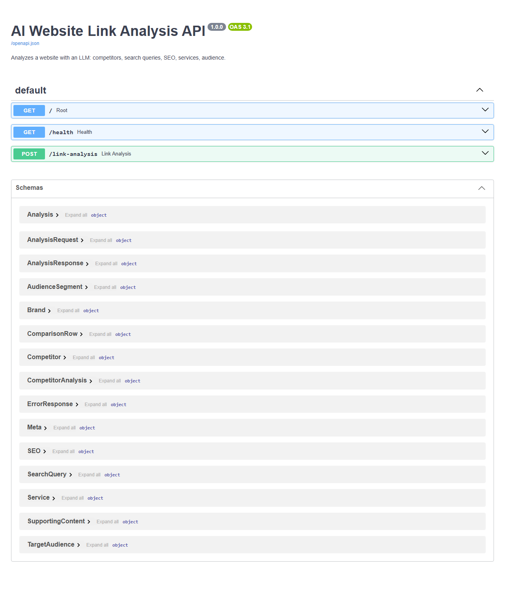

# AI Website Link Analysis API

FastAPI service that takes a website URL, fetches and cleans the real page content, and uses an LLM to return five structured sections: **competitor comparison, top 5 search queries, SEO improvements, top 5 services, target audience**.

- **Live demo:** https://link-analysis-api-self.vercel.app
- **Endpoint:** `POST https://link-analysis-api-self.vercel.app/link-analysis`
- **API docs:** https://link-analysis-api-self.vercel.app/docs
- **Repo:** https://github.com/Shaurya55555/link-analysis-api
- **Tests:** 31 passing (`pytest -q`), also run by GitHub Actions on every push

```bash
curl -X POST https://link-analysis-api-self.vercel.app/link-analysis \
  -H "Content-Type: application/json" -d '{"url": "https://zerodha.com"}'
```

An analysis takes roughly 15 to 40 seconds (see measured results). Repeat requests for the same site are served from cache in about 1 second. The public demo is rate limited (20 analyses per IP per hour) to protect the API key.



## Run locally

```bash
python -m venv .venv && source .venv/bin/activate   # Windows: .venv\Scripts\activate
pip install -r requirements.txt
cp .env.example .env        # set GEMINI_API_KEY (or OPENAI_API_KEY / ANTHROPIC_API_KEY + LLM_PROVIDER)
uvicorn app.main:app --host 0.0.0.0 --port 4000
```

Docs at http://localhost:4000/docs. With Docker: `docker compose up --build` (reads `.env`).
`pytest -q` needs no API key: the LLM and network are mocked.

## Request and response

Request: `{"url": "https://example.com"}` (scheme optional).

Response (abridged; real full outputs are in [`samples/`](samples/)):

```json
{
  "success": true,
  "website": "https://zerodha.com/",
  "brand": {"name": "Zerodha", "category": "...", "summary": "..."},
  "analysis": {
    "competitor_analysis": {
      "brand_overview": "...",
      "competitors": [{"name": "Groww", "website": "https://groww.in", "source": "ai_suggested",
                       "strengths": [], "weaknesses": [],
                       "live_check": {"reachable": true, "page_title": "Groww - Online Demat, Trading ..."}}],
      "comparison_table": [{"competitor_name": "Groww", "comparison": "Target Market", "your_brand": "...", "competitor": "..."}],
      "strengths": [], "opportunities": []
    },
    "target_search_queries": [{"query": "...", "platforms": ["Google", "LinkedIn"], "intent": "...",
                               "business_relevance": "...", "target_audience": "...", "search_volume": null}],
    "seo_improvements": {"primary_keyword": "...", "secondary_keywords": [], "long_tail_keywords": [],
                         "business_keywords": [], "recommended_title": "...", "meta_description": "...",
                         "supporting_content": {"landing_pages": [], "industry_pages": [], "faqs": [], "blog_topics": [], "location_pages": []}},
    "top_services": [{"name": "...", "description": "...", "target_industry": "...", "target_customer": "...",
                      "main_benefit": "...", "source": "website"}],
    "target_audience": {"primary_audience": [], "secondary_audience": [], "industries": [], "business_types": [],
                        "customer_profiles": [], "geographic_focus": [], "customer_needs": [], "interests": [],
                        "recommended_segments": [{"audience": "...", "business_type": "...", "requirement": "..."}]}
  },
  "meta": {"provider": "gemini", "model": "gemini-3.5-flash-lite", "llm_seconds": 16.9, "input_tokens": 2015,
           "output_tokens": 3285, "cached": false, "pages_read": 3, "request_id": "5fb00be13318", "notes": []}
}
```

Errors always use `{"success": false, "error": "...", "code": "..."}`:

| HTTP | code | When |
|---|---|---|
| 400 | `invalid_or_blocked_url` | malformed URL, or private/internal target (SSRF protection) |
| 422 | `invalid_request` | body is not `{"url": ...}` |
| 429 | `rate_limited` | per-IP hourly limit reached |
| 502 | `website_unreachable` | DNS failure, timeout, HTTP error, non-HTML or empty page |
| 502 | `llm_failure` | LLM unavailable or output failed validation after retries |

Every response carries an `X-Request-ID` header, repeated in `meta.request_id` and in the server log. Requests and responses for all the cases above are in [`evidence/request_log.txt`](evidence/request_log.txt), with the matching server log in [`evidence/server.log`](evidence/server.log). Ready-made requests: [`examples/requests.http`](examples/requests.http).

## How it works

```
URL -> validate (SSRF) -> fetch (re-validated on each redirect) -> extract + clean (home + up to 2 pages)
    -> LLM (JSON mode, strict schema prompt) -> Pydantic validation (retry once with the error fed back)
    -> live-check suggested competitors -> JSON response (+ cache)
```

1. **Validate** (`utils/validators.py`): http/https only, no credentials in the URL, limited ports, and DNS is resolved so every address must be public. Blocks localhost, private ranges, link-local (cloud metadata `169.254.169.254`), multicast and reserved ranges.
2. **Fetch** (`services/website_extractor.py`): redirects are followed manually and every hop is re-validated, so a public URL cannot redirect into an internal one. Response size, content type and timeouts are enforced. Charset is detected from the raw bytes.
3. **Extract**: title, meta and OpenGraph tags, headings and body text from `<main>`. Scripts, nav, footer, forms and duplicate lines are stripped to save tokens. Up to 2 extra same-site pages (about, services, products, pricing) are read from the nav links so the model sees more than the home page.
4. **Analyze** (`services/analysis_service.py`, `llm_service.py`): one LLM call produces all five sections. Output is validated with Pydantic (exactly 5 search queries, exactly 5 services, at least 3 competitors; extras are trimmed, shortfalls trigger a corrective retry).
5. **Verify competitors** (`services/competitor_service.py`): competitors are LLM suggestions and are labeled `source: "ai_suggested"`. Each suggested homepage is fetched live (SSRF-safe) and the real page title and description are attached, so the reader can see whether the suggestion exists.
6. **Resilience**: on Gemini 429/5xx, malformed JSON or timeout the request retries once, then falls through a chain of fallback Gemini models, then an optional second provider. When a fallback answers, `meta.notes` says so. A real production run during testing used this path (primary model unavailable, fallback answered).

### Decisions that follow the brief's rules

| Rule from the brief | What the code does |
|---|---|
| Use actual website content | Prompt contains only extracted site text; the model is told never to give generic output |
| Do not invent search volumes | `search_volume` is always `null`; no volume source is integrated |
| Competitors credible or marked as AI suggestions | Always `ai_suggested`, plus a live reachability check |
| Label inferred services | Each service has `source: "website"` or `"inferred"` |
| Handle access restrictions and API failures | Typed error codes above, no stack traces or provider text leaked |
| Protect API keys | Env vars only, `.env` git-ignored, Vercel env var stored as Sensitive |
| SSRF protection | See "Validate" and "Fetch" above, covered by 12+ test cases including redirect-to-metadata |
| Valid structured JSON | Provider JSON mode + Pydantic validation + retry |
| Actual pricing; measured vs estimated | See the LLM section; measured and calculated figures are separated |

## LLM research: cost, speed and accuracy

Prices are USD per 1M tokens, standard paid tier, non-batch, read from the vendors' official pricing pages on 2026-11-19. Pricing pages change, so recheck before production use.

### A. Platform comparison

| Provider | Model | Input / Output | Context (in / out) | Structured JSON | Measured here |
|---|---|---|---|---|---|
| Google | `gemini-3.5-flash-lite` | $0.30 / $2.50 | 1,048,576 / 65,536 | Supported | yes |
| Google | `gemini-3.1-flash-lite` | $0.25 / $1.50 (1) | not verified | Gemini JSON mode used | yes |
| Google | `gemini-3-flash-preview` | $0.50 / $3.00 (1) | not verified | Gemini JSON mode used | yes |
| OpenAI | `gpt-5.6-luna` (nano tier) | $0.20 / $1.20 | 1,050,000 / 128,000 | Supported | no |
| OpenAI | `gpt-6-luna` | $0.10 / $0.50 | not verified | not verified | no |
| Anthropic | `claude-haiku-5-5` | $0.10 / $0.50 (prompts up to 100K) | 1M / 128K | not confirmed | no |

(1) These two prices came from a model-extracted summary of a long pricing page, not verbatim text. The `gemini-3.5-flash-lite` price and the OpenAI and Anthropic rows were read directly. OpenAI and Anthropic providers are implemented (`LLM_PROVIDER=openai|anthropic`) and unit-tested against mocked HTTP, but **not run live** because no keys for them were used. They are compared on price and documented limits only.

### B. Measured results (real runs, 2026-11-19)

Same 5 sites for every model: zerodha.com, stripe.com, fastapi.tiangolo.com, bluestone.com, practo.com. One run per site per model, so read these as indicative, not statistical. Raw data: [`samples/benchmark_*.json`](samples/), full outputs per model in `samples/<model>/`, tables in [`evidence/`](evidence/).

| Model | Valid JSON | LLM call (avg, min to max) | End-to-end avg | Avg tokens in / out | Calculated cost per analysis | Competitors reachable |
|---|---|---|---|---|---|---|
| `gemini-3.5-flash-lite` | 5 / 5 | 16.6 s (13.6 to 18.6) | 25.9 s | 2,362 / 3,477 | about $0.0094 | 90% |
| `gemini-3.1-flash-lite` | 4 / 5 (one provider 503) | 11.0 s (8.2 to 14.0) | 19.4 s | 2,496 / 2,104 | about $0.0038 | 83% |
| `gemini-3-flash-preview` | 5 / 5 | 21.3 s (15.4 to 29.1) | 27.2 s | 2,399 / 2,300 | about $0.0081 | 88% |

Token counts and latency are measured. Cost is calculated from measured tokens at the list prices above. End-to-end includes fetching up to 3 pages and live-checking the suggested competitors.

**Groundedness checks** (automatic, `scripts/benchmark.py`): in every successful run the brand name appeared in the fetched site text, and 100% of services labeled `website` had their key terms present in the extracted content. This is a deliberately simple keyword test: it shows the output is tied to the real site, but it is **not an accuracy score**. No ground-truth benchmark was run, so no accuracy claim is made beyond that and a manual read of the outputs.

An honest note on the numbers: the first benchmark (before the full 15-row comparison table was added) measured about 7.5 s per call and about 2.5k output tokens for `gemini-3.5-flash-lite`. The richer output roughly doubled latency and output cost, which is the trade-off for the per-competitor table.

### C. Cost optimization applied

- HTML is stripped to meaningful text (no scripts, nav, footer, forms, duplicate lines) and capped at `MAX_CONTENT_CHARS` (about 2.0k to 3.3k input tokens per site in practice).
- One LLM call produces all five sections, so page content is sent once.
- Per-URL cache with TTL (1 hour) avoids repeat calls; a cached response took 1.4 s in the logged run.
- Compact schema prompt; output capped at 8,192 tokens.
- Cheapest viable model as default, bigger model only as fallback on failure.
- Output tokens dominate cost (80 to 90% of spend in the measured runs), so the largest lever is trimming output length (for example fewer comparison rows), then provider context caching for the fixed instruction prompt, and batch pricing for offline bulk runs.

### D. Final recommendation

- **Provider and model:** Google `gemini-3.5-flash-lite` (the deployed default).
- **Estimated and measured usage:** about 2.4k input and 3.5k output tokens per analysis (measured average), about $0.009 per analysis, 13 to 19 s model time, 20 to 30 s end to end.
- **Why:** it was the only model whose price I could read verbatim from the official page, it succeeded on 5 of 5 sites, produced the most complete output (the full per-competitor table), and has a free tier for development and demos.
- **Fallback:** `gemini-3.1-flash-lite`, then `gemini-3-flash-preview` (automatic), then an optional OpenAI-compatible or Anthropic provider (`FALLBACK_PROVIDER`).
- **If cost and speed matter more than richness:** `gemini-3.1-flash-lite` was about 2.5x cheaper and about 1.5x faster in these runs with the same measured groundedness. Its one failure was a provider 503, which the fallback chain now absorbs. Switch with `GEMINI_MODEL`.
- **Balancing approach:** cheap small model by default, escalate on overload or failed validation, cache aggressively. Before a production switch, run `scripts/benchmark.py` on a labeled set to measure real accuracy.

## Project layout

```
app/main.py                       FastAPI app, error mapping, rate limit, request ids
app/config.py                     env-based settings
app/schemas.py                    Pydantic request/response/LLM-output models
app/services/website_extractor.py safe fetch + content extraction
app/services/llm_service.py       Gemini / OpenAI-compatible / Anthropic, JSON mode, retry + fallback chain
app/services/analysis_service.py  prompt, validation + retry, cache
app/services/competitor_service.py live checks of suggested competitors
app/utils/validators.py           URL validation and SSRF protection
tests/test_link_analysis.py       31 tests: SSRF (incl. redirects), extraction, LLM handling, fallback, API flow
scripts/benchmark.py              measured latency, tokens, validity, groundedness
samples/                          real outputs and benchmark data
evidence/                         request log, server log, live /docs screenshot, benchmark tables
examples/requests.http            ready-to-run requests incl. error cases
Dockerfile, docker-compose.yml, .github/workflows/tests.yml, vercel.json
```

## Limitations

- Sites that render content only with JavaScript return little text and give a clear `website_unreachable` error rather than guessing.
- Competitor strengths and gaps come from the model; the live check only confirms the suggested site exists. No search-volume or ranking data is provided.
- Rate limiting and caching are in-memory per instance, which is enough for a demo but would move to Redis in production.
- The free Gemini tier can return 503/429 under load; the fallback chain and retries reduce, but cannot remove, that risk.
- Latency varies run to run (the same site took 17 to 22 s on two runs).
